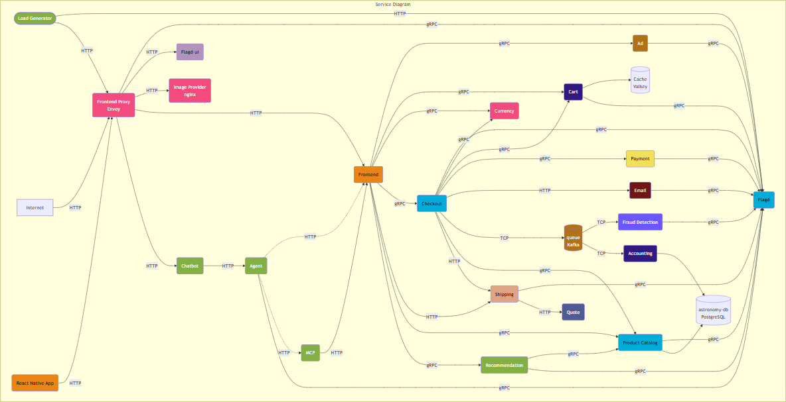
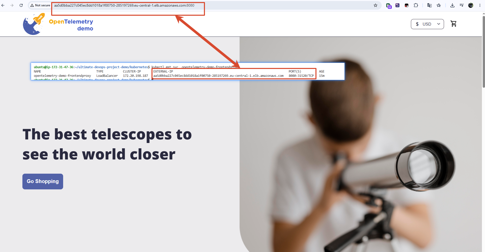

# End-to-End Microservices Deployment, CI/CD, and Observability on AWS EKS

This repository contains the infrastructure code, deployment manifests, and CI/CD pipelines used to containerize, deploy a complex polyglot microservices application (based on the OpenTelemetry Demo app). The project simulates a production-grade DevOps environment incorporating Infrastructure as Code (IaC), GitOps, Automations, and Cloud practices.


## Tech Stack

| Area | Tools |
|---|---|
| Cloud Provider | AWS (EC2, EKS, IAM, S3, DynamoDB) |
| Containerization | Docker, Docker Compose (for local testing) |
| Orchestration | Kubernetes, Amazon EKS |
| Networking / Ingress | AWS Load Balancer Controller, ALB Ingress |
| Infrastructure as Code | Terraform (VPC + EKS modules, S3 + DynamoDB remote backend) |
| CI | GitHub Actions |
| CD / GitOps | Argo CD |

## Project Structure

```
.
├── docker/               # Dockerfiles for each service + docker-compose setup
├── kubernetes/           # Per-service K8s manifests (deploy + svc) and complete-deploy.yaml
├── terraform/            # Terraform notes + eks-install (VPC & EKS modules, remote backend)
├── cicd/                 # GitHub Actions CI pipeline + GitOps/Argo CD notes
├── notes/                # General setup notes (EC2, running the project locally)
├── notes-kubernetes/     # Kubernetes concepts and step-by-step notes
└── README.md
```

## The Application

The demo application is a distributed e-commerce app ("Astronomy Shop") made up of independent microservices communicating over gRPC/HTTP and Kafka, including:

`frontend`, `frontendproxy`, `productcatalog`, `cart`, `checkout`, `payment`, `currency`, `shipping`, `email`, `accounting`, `ad`, `recommendation`, `quote`, `frauddetection`, `imageprovider`, `loadgenerator`, `kafka`, `valkey` (cache), and `flagd` (feature flagging).

Services are written in different languages (Go, Java, Python, .NET, etc.), which made it a good playground for practicing multi-stage, language-specific Docker builds.


## Infrastructure & Deployment Steps

### 1. Containerization & Local Development (Docker)
Before moving anything to the cloud, I focused on containerizing the application's polyglot services and establishing a solid local testing workflow.

*   **Multi-Stage Dockerfiles:** Wrote custom, language-specific production Dockerfiles for the [Go Product Catalog](/docker/Dockerfile.ProductCatalog.yaml), [Java Ad service](/docker/Dockerfile.Ad.yaml), and [Python Recommendation engine](/docker/Dockerfile.Recommendation.yaml). I heavily relied on multi-stage builds to strip out build-time dependencies, keeping the final production images minimal, lightweight, and secure. (Read my [notes on multi-stage builds here](/docker/04-dockerfile-Product-Catalog.md)).

*   **Language-Specific Build Steps:** Documented how different environments require unique build mechanisms, particularly focusing on how binary compilation works for the [Go-based service](/docker/03-build-services.md).
*   **Local Orchestration:** Configured a unified [Docker Compose specification](/docker/docker-compose.yaml) to spin up the entire application mesh, including dependencies, locally with a single command. This mirrored the production service topology and verified connectivity before EKS migration. (Check out the [local run guide](/notes/02-run-the-project-locally.md)).

### 2. Kubernetes (Orchestration & Traffic Management)
Transitioned the application from standalone containers to a highly available, self-healing orchestration layer on AWS EKS to manage microservice lifecycles, service discovery, and zero-downtime scaling.

*   **Architecture & Cluster Access:** Established secure, programmatic cluster communication using fine-grained [Service Accounts](/notes-kubernetes/13-kubernetes-service-account.md) and configured context-driven cluster switching via [Kubeconfig Managements](/notes-kubernetes/12-connect-to-Kubernetes-cluster.md).
*   **Decoupled Workloads:** Applied declarative state management across polyglot microservices via [Deployment and Service Manifests](/notes-kubernetes/15-deployment-resource-structure.md). Used automated [Scaling & Self-Healing](/notes-kubernetes/14-kubernetes-resources.md) patterns to guarantee zero service disruption.
*   **Production Networking & Cost Optimization:** 
    *   Identified and mitigated the financial and architectural [Disadvantages of Raw Cloud LoadBalancer Service Types](/notes-kubernetes/19-disadvantages-of-LB-service-type.md) (such as avoiding a dedicated AWS Network Load Balancer per individual microservice).
    *   Implemented an [Ingress-Driven Traffic Architecture](/notes-kubernetes/20-ingress-and-ingress-controller.md) to multiplex multiple service endpoints behind a single routing layer.
    *   Deployed and configured the [AWS Load Balancer (ALB) Ingress Controller](/notes-kubernetes/21-deploying-ALB-ingress-controller.md), allowing unified internal routing via layer-7 rules and dynamic target-group bindings mapped directly to pods.
*   **Manifests Reference:** Access the granular, standalone [per-service manifests](/kubernetes/) and the consolidated [full deployment specification file](/kubernetes/complete-deploy.yaml) used for progressive delivery.

### 3. Infrastructure as Code (Terraform)
Instead of clicking around the AWS Console, I treated the entire network and cluster setup as code. I mapped out and provisioned a highly available cloud environment in the `eu-central-1` (Frankfurt) region.

*   **Network & High Availability:** Designed a custom VPC split into [Public and Private Subnets](/terraform/eks-install/) mapped across 3 Availability Zones (`eu-central-1a/b/c`). All compute nodes run inside the private subnets for security, while ingress traffic enters through the public ones.
*   **Production State Management:** Set up a secure team-ready backend workflow. I moved away from risky local state files to a [Remote S3 Backend](/terraform/09-terraform-remote-backend-using-s3.md) combined with [DynamoDB Distributed State Locking](/terraform/10-terraform-state-locking-using-dynamodb.md). This setup prevents state corruption and resource overriding when multiple people run pipelines concurrently. (See how I bootstrapped the [S3 bucket and DynamoDB table here](/terraform/11-terraform-create-S3bucket-and-dynamodb.md)).
*   **Modular Architecture:** Avoided writing a single, massive monolithic file. I structured the codebase into clean, reusable [VPC and EKS modules](/terraform/eks-install/). This keeps the code maintainable, decoupled, and easy to scale.
*   **Core Concepts & Basics:** Kept detailed notes on day-to-day operations, including the [Terraform Lifecycle](/terraform/05.terraform-lifecycle.md), [AWS Provider settings](/terraform/06-terraform-AWS-configuration.md), and standard [State File mechanics](/terraform/07-terraform-statefile.md) / [management strategies](/terraform/08-terraform-statefile-management.md).


 


### 4. CI/CD & GitOps
Deployed **Argo CD** inside the EKS cluster to monitor this Git repository. Any changes to the `k8s-manifests/` folder automatically trigger a progressive sync/reconciliation loop to heal cluster drift.
- [CI concepts](/cicd/23-cicd.md) — checkout → test → build → image → scan → push → update manifest
- [Product Catalog CI pipeline (GitHub Actions)](/cicd/24-Product-Catalog-Service-ci.yaml.md) ([workflow file](/cicd/ProductCatalog-ci.yaml))
- [GitOps principles](/cicd/25-GitOps.md) — keeping the desired cluster state in Git and letting a controller reconcile it
- [Argo CD setup and usage](/cicd/26-ArgoCD.md) — installation, exposing the UI, retrieving the admin password, and connecting a Git repo as an application

## How It Fits Together

```
Developer pushes code
        │
        ▼
   CI (GitHub Actions)
   build → test → docker build → scan → push image → update K8s manifest
        │
        ▼
     Git repo (desired state)
        │
        ▼
      Argo CD  ── watches the repo, detects drift
        │
        ▼
  Kubernetes cluster (EKS)
   reconciled to match the manifest — new version deployed
```

Infrastructure (VPC + EKS cluster) is provisioned ahead of time with Terraform, using an S3 backend for remote state and a DynamoDB table for state locking, so the setup is safe for multiple contributors.

## Running It Locally

```bash
git clone https://github.com/iam-veeramalla/ultimate-devops-project-demo.git
cd ultimate-devops-project-demo
docker compose up
```

See [notes/02-run-the-project-locally.md](/notes/02-run-the-project-locally.md) for details, including common gotchas (e.g. disk space on a fresh EC2 instance and opening the right security group ports).

## Deploying to EKS

```bash
# 1. confirm you're pointed at the right cluster
kubectl config current-context

# 2. create the service account
kubectl apply -f kubernetes/serviceaccount.yaml

# 3. deploy every microservice
kubectl apply -f kubernetes/complete-deploy.yaml

# 4. check status
kubectl get all
kubectl get svc
```

Once the AWS Load Balancer Controller and an Ingress resource are set up (see the Kubernetes section above), the app becomes reachable through an ALB instead of a per-service LoadBalancer.

## Key Takeaways

- **Docker**: multi-stage builds keep images small and language-agnostic across a polyglot microservice stack.
- **Kubernetes**: Deployments give self-healing/scaling; Services provide stable networking; Ingress + ALB Controller avoid provisioning a separate cloud Load Balancer per service.
- **Terraform**: remote state (S3) + locking (DynamoDB) are what make IaC safe for teams, not just individuals.
- **CI/CD**: separating CI (build/test/push image) from CD (deploy to cluster) is what GitOps is built on — Argo CD continuously reconciles the cluster to match what's declared in Git, instead of anyone running `kubectl apply` by hand.


